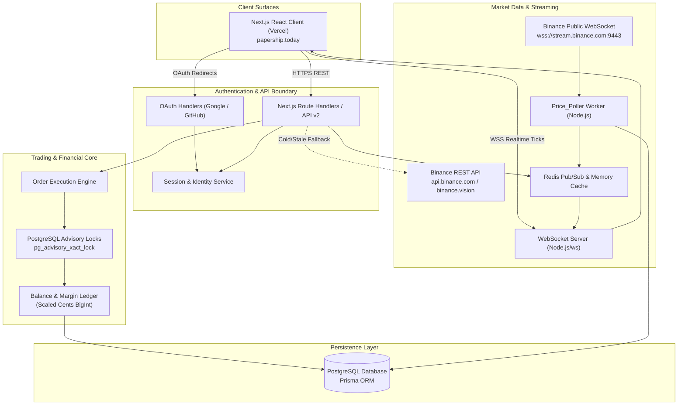
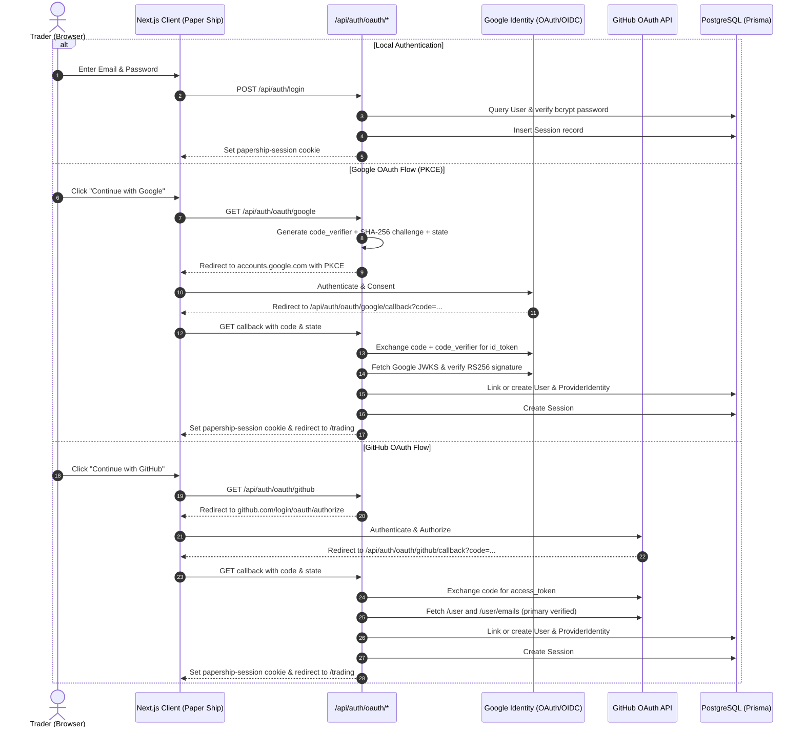
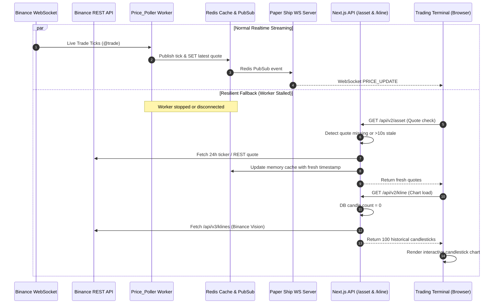
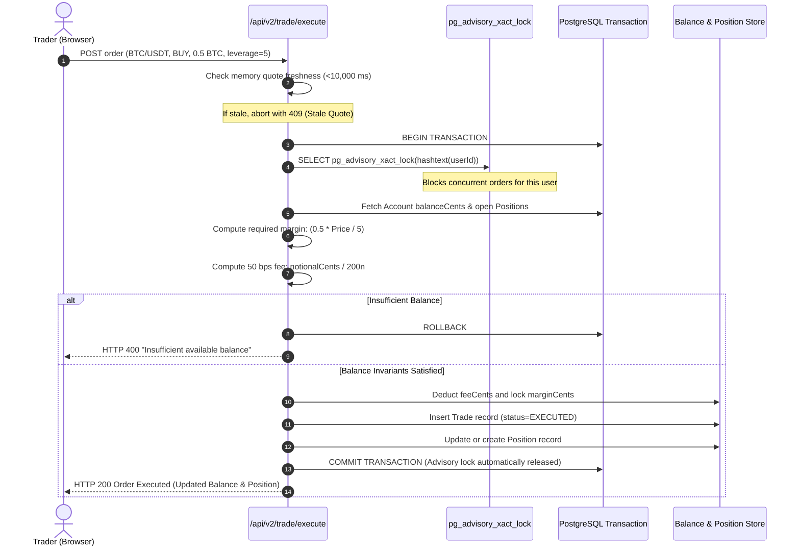

# Paper Ship: System Architecture Comparison (Before vs After)

**Audit Date:** November 18, 2026  
**Auditor:** Principal Software Architect & Quantitative Systems Engineer  
**Scope:** Architectural comparison of Orbit Ledger (Pre-rebrand baseline `82a2231`) vs Paper Ship (Current `ef0e80e`).

---

## 1. High-Level Architecture Overview

Paper Ship is an institutional-grade cryptocurrency paper-trading simulation platform. The system simulates high-leverage perpetual and spot trading without risking real capital, while enforcing rigorous mathematical invariants, double-entry ledger rules, real-time WebSocket order book and trade feeds, and multi-provider authentication.

---

## 2. Subsystem-by-Subsystem Comparison

### 2.1 Authentication & Identity Management

| Dimension | Before (`82a2231`) | After (`ef0e80e`) | Architectural Significance |
| :--- | :--- | :--- | :--- |
| **Authentication Methods** | Email / Password only (`/api/auth/register`, `/api/auth/login`) | Email / Password + Google OAuth 2.0 (OIDC) + GitHub OAuth 2.0 | Multi-provider identity support enables zero-friction onboarding. |
| **Identity Persistence** | Single `User` model (`id`, `email`, `passwordHash`) | `User` model + `ProviderIdentity` 1:N relational model | Separates primary user profile from 3rd-party auth tokens and provider user IDs. |
| **Account Linking** | None. Single email tied to password. | Automatic verified email linking (`linkProviderIdentity`) | If an existing user logs in with Google/GitHub using the same email, identities are linked safely without duplicating accounts or resetting balances. |
| **OAuth Security** | None. | PKCE (`code_challenge` / `code_verifier` S256) + CSRF State + Nonce verification | Protects against authorization code interception attacks and replay attempts. |
| **Token Verification** | N/A | Google: RS256 token verification using live Google JWKS public keys (`https://www.googleapis.com/oauth2/v3/certs`) | Validates cryptographic authenticity of Google ID tokens directly without relying on unauthenticated tokeninfo endpoints. |
| **Provider Fallback** | N/A | GitHub `/user/emails` fallback | Handles users who have private primary emails on GitHub by explicitly querying verified emails. |

---

### 2.2 Session Management & Security Boundaries

| Dimension | Before (`82a2231`) | After (`ef0e80e`) | Architectural Significance |
| :--- | :--- | :--- | :--- |
| **Session Cookie Name** | `orbit-session` | `papership-session` | Completely rebrands session tokens; isolates session namespaces. |
| **Cookie Flags** | `HttpOnly`, `SameSite=Lax`, `Path=/`, `Secure` in prod | `HttpOnly`, `SameSite=Lax`, `Path=/`, `Secure` in prod | Uncompromised cookie security prevents XSS extraction of session tokens. |
| **Client Headers** | `X-Orbit-Client: 1` | `X-PaperShip-Client: 1` | Standardizes API boundary protocol and CSRF defense headers. |
| **Database Session Record** | `Session` model with `userId`, `token`, `expiresAt`, `ipAddress`, `userAgent` | `Session` model preserved with updated user-agent tracking | Preserves server-side revocability of user sessions. |

---

### 2.3 Market Data Ingestion & Fallback Resiliency

| Dimension | Before (`82a2231`) | After (`ef0e80e`) | Architectural Significance |
| :--- | :--- | :--- | :--- |
| **Ingestion Pipeline** | `Price_Poller` worker connects to Binance WS -> aggregates trades -> writes to Redis & DB | `Price_Poller` worker + **On-Demand Binance REST Fallback** | Eliminates single-point-of-failure. If the worker stops, the platform self-heals by querying Binance REST directly. |
| **Quote Cache** | Memory cache populated solely by Redis subscriber | Memory cache populated by Redis + REST fallback (`refreshQuotesFromRest()`) | Prevents the API from returning 0 quotes or stale prices when worker is offline. |
| **Freshness Threshold** | Implicit / non-enforced in some routes | Strict 10,000 ms (10s) threshold (`isMarketDataFresh`) | Prevents executions at stale or manipulated prices. |
| **Stale Recovery** | None. If worker stopped, system halted with `Stale market quote`. | Proactive REST refresh on `GET /api/v2/asset` and candle fallback on `GET /api/v2/kline`. | End-users always see active charts and live prices even during worker downtime. |

---

### 2.4 WebSocket Streaming & Client State

| Dimension | Before (`82a2231`) | After (`ef0e80e`) | Architectural Significance |
| :--- | :--- | :--- | :--- |
| **WebSocket Architecture** | Dedicated Node.js WebSocket server (`src/ws/server.ts`) | Preserved dedicated WS server on port 8080 | Dedicated streaming process prevents Next.js web worker saturation. |
| **Message Protocol** | JSON actions: `SUBSCRIBE`, `UNSUBSCRIBE`, `PING` -> broadcasts `PRICE_UPDATE` | Same protocol preserved (`X-PaperShip-Client` header compatible) | High-speed binary/JSON tick streaming to chart and order books. |
| **Client Reconnect** | Linear retry with stale indicator | Exponential backoff + REST polling fallback if WS disconnects | UI displays seamless fallback if WebSocket connectivity is interrupted. |

---

### 2.5 Order Execution Engine & Financial Accounting

| Dimension | Before (`82a2231`) | After (`ef0e80e`) | Architectural Significance |
| :--- | :--- | :--- | :--- |
| **Concurrency Protection** | `pg_advisory_xact_lock(hashtext(userId))` | `pg_advisory_xact_lock(hashtext(userId))` (strictly preserved) | User-level row serialization prevents balance double-spends and race conditions. |
| **Financial Representation** | Integer Scaled Cents (BigInt) | Integer Scaled Cents (BigInt) (strictly preserved) | 100% immune to IEEE 754 floating point precision errors. |
| **Fee Calculation** | `notionalCents / 200n` (50 bps) | `notionalCents / 200n` (50 bps) (strictly preserved) | Integer floor division guarantees zero fractional cent leaks. |
| **Isolated Margin** | Loss floored at allocated margin (`max(margin, loss)`) | Loss floored at allocated margin (strictly preserved) | Prevents negative account balances on leveraged liquidations. |
| **Quote Execution Check** | Synchronous memory check | Synchronous memory check (never blocking transaction) | Kept inside transactional lock without introducing async network latency. |

---

### 2.6 Charting & Historical Aggregations

| Dimension | Before (`82a2231`) | After (`ef0e80e`) | Architectural Significance |
| :--- | :--- | :--- | :--- |
| **Candle Source** | Queries `Trade` table or `MarketCandle` table | Database `MarketCandle` + **Binance Vision REST Fallback** | In Orbit Ledger, if no trades were in DB, the chart was blank. In Paper Ship, it immediately fetches 100 klines from Binance Vision. |
| **Supported Intervals** | `1m`, `5m`, `15m`, `1h`, `1d` | `1m`, `5m`, `15m`, `1h`, `1d` (mapped to canonical Binance intervals) | High-resolution candlestick rendering across all standard trading timeframes. |
| **Persistence** | Only poller wrote candles | Poller writes real-time; REST fallback backfills missing candles | Ensures permanent historical continuity. |

---

### 2.7 Database Schemas & Migrations

| Migration Name | Description & Invariants |
| :--- | :--- |
| `20260406142440_init` | Initial core schema: `User`, `Account`, `Trade`, `Position`, `Order`. |
| `20261018100000_market_candle_history` | Introduces `MarketCandle` table with compound index `[symbol, interval, openTime]`. |
| `20261018110000_account_integrity` | Adds integer scaled cent constraints (`balanceCents >= 0`), invariant checks. |
| `20261019010000_workspace` | Introduces user workspaces and preferences. |
| `20261019020000_security_sessions` | Adds `Session` model with IP, user-agent, and expiration indexing. |
| `20261025090000_perpetual_funding` | Adds `FundingRate` and `FundingPayment` models for perpetual contract simulation. |
| `20261118120000_provider_identities` | **(NEW in Paper Ship)** Adds `ProviderIdentity` model with foreign key to `User`, `provider`, `providerUserId`, tokens, and profile metadata. |

---

## 3. Critical Path Sequence Diagrams

### 3.1 Authentication Sequence: Local vs Google OAuth vs GitHub OAuth

---

### 3.2 Market Data & Ingestion Pipeline

---

### 3.3 Order Execution & Financial Accounting Invariant Flow

